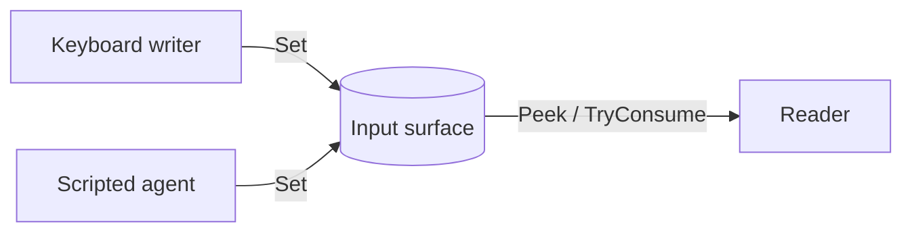

# The Input Surface

An **input surface** is a plain type holding a project's input vocabulary:

```cs
public class CharacterInput : MonoBehaviour
{
    public Vector2 Move;                                  // continuous
    [FixedInputWindow(5)] public FixedInputEvent Attack;  // discrete, lenient
    public FixedInputEvent Evade;                         // discrete, frame-exact
}
```

This package ships no verbs. What it supplies is the type discrete intents are made of, a clock they can agree on, and the rules that make a surface swappable.

A **writer** fills a surface. A device reader and a scripted agent are both writers, and nothing distinguishes them. A **reader** acts on a surface and reads nothing else.



Once a project holds that line, a character driven by a keyboard and the same character driven by a script run the identical code. Every mechanic written for a player works for an agent the day it ships, because there is no second path to drift out of sync: no parallel agent attack, no agent-only movement, no mechanic that quietly only works for one of them.

A surface can be anything that holds fields: a `MonoBehaviour`, a plain class, a struct, or an `IComponentData` under [Entities](./entities.md).

## The contract

Six rules. They are short, and each one is load-bearing.

### 1. A reader reads only the input surface

Never a device, an input action, or a writer.

**Break it and** the reader can no longer be driven by anything else, which is the entire benefit gone.

### 2. Continuous intents are plain fields. Discrete intents are `FixedInputEvent`

**Break it and** a continuous value gets a tick it does not need, or a discrete press becomes a `bool` somebody forgets to clear and it fires twice.

### 3. The reader owns execution

A writer supplies values. It never calls a movement, animation or combat API directly.

**Break it and** a different writer driving the same reader produces different behavior, and the surface has stopped being a contract. This is the rule most often broken by accident, because the code that computed a direction is right there and moving the character from it is one line.

### 4. Exactly one writer per surface per frame

**Break it and** two writers overwrite each other and one of the presses is silently lost. The usual cause is a scripted writer driving a character whose device writer is still enabled.

The [diagnostics](./diagnostics.md#two-writers-in-one-step) can report it, with both call sites.

### 5. A writer in `FixedUpdate` runs before its readers in the same step. A writer in `Update` binds to the next step

**Break it and** every intent expires unconsumed, because the reader tests a step the writer has not stamped yet. This is the one rule the package cannot enforce, only [report](./diagnostics.md#intents-nobody-consumed).

See [The Tick](./the-tick.md) for why both writer positions work.

### 6. Conditions call `Peek`. The code that acts calls `TryConsume`

**Break it and** consider two transitions out of one state, one testing attack plus a timing window and one testing attack alone. A condition that consumed while merely testing would eat the press whenever its own second clause failed, and the second transition would never see it.

See [Fixed Input Event](./fixed-input-event.md#peek-and-tryconsume).

## Swapping writers

Swapping is enabling one writer and disabling the other. Clear the continuous fields a writer owns when it is disabled, or the body keeps walking in the last direction it was given:

```cs
void OnDisable() => _input.Move = Vector2.zero;
```

Discrete intents need no cleanup. Whatever the old writer left armed expires on its own.
