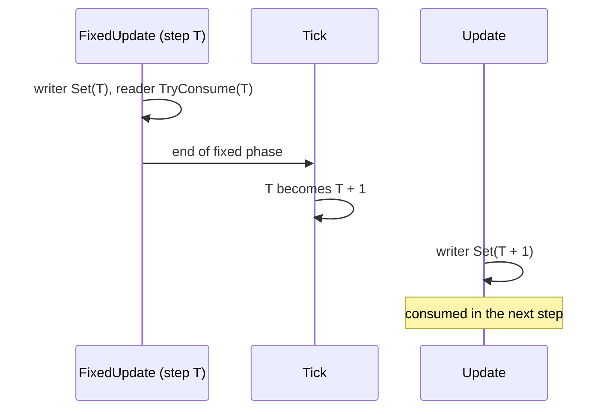

# The Tick

:::note[Definition]
**Tick** is the index of the fixed simulation step that will consume intents set right now. It advances at the **end** of the fixed-update phase.

An intent set at tick `T` is consumable only during step `T`, or, when a reader passes a window, during steps `T` through `T + window`.
:::

Advancing at the end is what makes both writer positions correct without either knowing about the other:

| Writer runs in | Sees | Consumed |
|---|---|---|
| `FixedUpdate` | `T`, the step it is inside | later in step `T` |
| `Update` | `T + 1`, because step `T` has closed | in step `T + 1` |



A frame rate faster than the fixed rate collapses repeated presses harmlessly. A frame rate slower costs exactly one step of latency and loses nothing.

## MyFixedTick

`MyFixedTick` is the ambient clock, and the one place a project changes which clock is authoritative.

```cs
uint tick = MyFixedTick.Current;   // the step that will consume intents set right now
```

| Member | |
|---|---|
| `Current` | The current tick of `Source`. |
| `Source` | The `ITickSource` every unwired reader uses. Settable. Defaults to `PlayerLoopTickSource`. |
| `HasCustomSource` | Whether a project-supplied source is in place, as opposed to the default. |
| `ResetToDefault()` | Drops back to the default source. |
| `StepClosing` | Raised when a fixed step closes, carrying the step that just finished. |

Outside play mode, the default source reads `0`, because no step is running. Reading it in edit mode does not install anything, and a source you set yourself, like a `ManualTickSource` in an edit mode test, is used as usual.

### Swapping the clock

Nothing about the default is mandatory:

```cs
MyFixedTick.Source = myNetcodeTick;          // a clock the project already owns
MyFixedTick.Source = new ManualTickSource(); // a test
```

See [Tick Sources](./tick-sources.md) for the sources the package ships and how to write your own.

### Entering play mode

Entering play mode resets the clock to its default source, clears every `StepClosing` observer and starts the count at `0`. That holds with **Enter Play Mode Options** and domain reload disabled too, so a `ManualTickSource` a test left behind can never become the next session's clock.

## Observing a step

`StepClosing` is raised after every reader in a step has had its chance and before the count advances, so tooling can look at a surface in its settled state without interfering:

```cs
void OnEnable()  => MyFixedTick.StepClosing += OnStepClosing;
void OnDisable() => MyFixedTick.StepClosing -= OnStepClosing;

void OnStepClosing(uint closingTick)
{
    // Every reader in step `closingTick` has run.
}
```

A handler that throws is logged and contained. A broken debug overlay cannot stop the clock it exists to observe.

:::warning
`StepClosing` is raised by `PlayerLoopTickSource` and `MonoBehaviourTickSource`. A custom source, including the [Entities](./entities.md) one, does not raise it, so tooling running off one has to sample where that clock's step closes.
:::

## Comparing ticks

Ticks are `uint` and wrap. Compare them with a wrapping subtraction, the same way `FixedInputEvent` does, rather than with `<`:

```cs
// Whether `tick` comes before `other`, across the wrap.
static bool Before(uint tick, uint other) => unchecked(tick - other) > uint.MaxValue / 2;
```

At 50 Hz the count wraps after about 2.7 years of play, so this matters less for a running game than for a tick taken from somewhere else, such as a network clock that does not start at zero.
