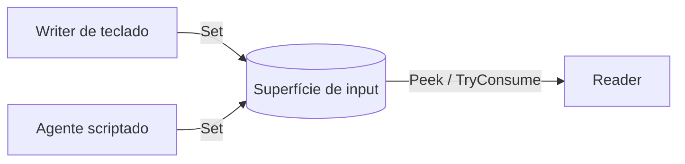

# A Superfície de Input

Uma **superfície de input** é um tipo simples que guarda o vocabulário de input de um projeto:

```cs
public class CharacterInput : MonoBehaviour
{
    public Vector2 Move;                                  // contínua
    [FixedInputWindow(5)] public FixedInputEvent Attack;  // discreta, tolerante
    public FixedInputEvent Evade;                         // discreta, exata no frame
}
```

Este pacote não traz nenhum verbo. O que ele fornece é o tipo do qual as intenções discretas são feitas, um relógio com o qual todos concordam e as regras que tornam uma superfície substituível.

Um **writer** preenche uma superfície. Um script que lê um dispositivo e um agente scriptado são ambos writers, e nada os distingue. Um **reader** age sobre uma superfície e não lê mais nada.



Quando um projeto respeita essa linha, um personagem controlado por um teclado e o mesmo personagem controlado por um script rodam exatamente o mesmo código. Toda mecânica escrita para um jogador funciona para um agente no dia em que é lançada, porque não existe um segundo caminho para sair de sincronia: nenhum ataque paralelo para o agente, nenhum movimento exclusivo do agente, nenhuma mecânica que discretamente só funciona para um dos dois.

Uma superfície pode ser qualquer coisa que guarde campos: um `MonoBehaviour`, uma classe simples, uma struct ou um `IComponentData` no [Entities](./entities.md).

## O contrato {/* #the-contract */}

Seis regras. Elas são curtas, e cada uma sustenta algo importante.

### 1. Um reader lê apenas a superfície de input {/* #1-a-reader-reads-only-the-input-surface */}

Nunca um dispositivo, uma input action ou um writer.

**Quebre-a e** o reader não pode mais ser controlado por nenhuma outra coisa, o que acaba com todo o benefício.

### 2. Intenções contínuas são campos simples. Intenções discretas são `FixedInputEvent` {/* #2-continuous-intents-are-plain-fields-discrete-intents-are-fixedinputevent */}

**Quebre-a e** um valor contínuo ganha um tick de que não precisa, ou um aperto discreto vira um `bool` que alguém esquece de limpar e dispara duas vezes.

### 3. O reader é dono da execução {/* #3-the-reader-owns-execution */}

Um writer fornece valores. Ele nunca chama diretamente uma API de movimento, animação ou combate.

**Quebre-a e** um writer diferente controlando o mesmo reader produz um comportamento diferente, e a superfície deixou de ser um contrato. Esta é a regra mais quebrada por acidente, porque o código que calculou uma direção está logo ali e mover o personagem a partir dela é uma linha.

### 4. Exatamente um writer por superfície por frame {/* #4-exactly-one-writer-per-surface-per-frame */}

**Quebre-a e** dois writers sobrescrevem um ao outro e um dos apertos se perde silenciosamente. A causa comum é um writer scriptado controlando um personagem cujo writer de dispositivo ainda está habilitado.

Os [diagnósticos](./diagnostics.md#two-writers-in-one-step) conseguem reportar isso, com os dois pontos de chamada.

### 5. Um writer no `FixedUpdate` roda antes dos seus readers no mesmo passo. Um writer no `Update` se liga ao próximo passo {/* #5-a-writer-in-fixedupdate-runs-before-its-readers-in-the-same-step-a-writer-in-update-binds-to-the-next-step */}

**Quebre-a e** toda intenção expira sem ser consumida, porque o reader testa um passo que o writer ainda não marcou. Esta é a única regra que o pacote não consegue garantir, só [reportar](./diagnostics.md#intents-nobody-consumed).

Veja [O Tick](./the-tick.md) para entender por que as duas posições de writer funcionam.

### 6. Condições chamam `Peek`. O código que age chama `TryConsume` {/* #6-conditions-call-peek-the-code-that-acts-calls-tryconsume */}

**Quebre-a e** considere duas transições saindo de um mesmo estado, uma testando ataque mais uma janela de timing e outra testando apenas ataque. Uma condição que consumisse enquanto só está testando comeria o aperto sempre que a sua própria segunda cláusula falhasse, e a segunda transição nunca o veria.

Veja [Fixed Input Event](./fixed-input-event.md#peek-and-tryconsume).

## Trocando writers {/* #swapping-writers */}

Trocar é habilitar um writer e desabilitar o outro. Limpe os campos contínuos que um writer controla quando ele for desabilitado, ou o corpo continua andando na última direção que recebeu:

```cs
void OnDisable() => _input.Move = Vector2.zero;
```

Intenções discretas não precisam de limpeza. O que quer que o writer antigo tenha deixado armado expira sozinho.
