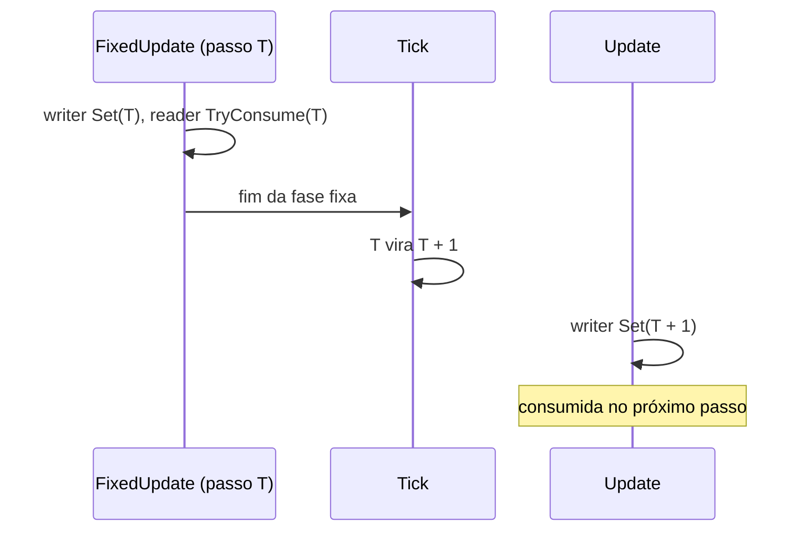

# O Tick

:::note[Definição]
**Tick** é o índice do passo fixo de simulação que vai consumir as intenções definidas neste momento. Ele avança no **fim** da fase de fixed update.

Uma intenção definida no tick `T` só pode ser consumida durante o passo `T` ou, quando um reader passa uma janela, durante os passos `T` até `T + window`.
:::

Avançar no fim é o que torna as duas posições de writer corretas sem que uma precise saber da outra:

| Writer roda em | Vê | Consumida |
|---|---|---|
| `FixedUpdate` | `T`, o passo dentro do qual está | mais adiante no passo `T` |
| `Update` | `T + 1`, porque o passo `T` já fechou | no passo `T + 1` |



Um frame rate mais rápido que a taxa fixa junta apertos repetidos sem causar problema. Um frame rate mais lento custa exatamente um passo de latência e não perde nada.

## MyFixedTick {/* #myfixedtick */}

`MyFixedTick` é o relógio ambiente, e o único lugar onde um projeto muda qual relógio é a referência.

```cs
uint tick = MyFixedTick.Current;   // o passo que vai consumir as intenções definidas neste momento
```

| Membro | |
|---|---|
| `Current` | O tick atual de `Source`. |
| `Source` | O `ITickSource` que todo reader sem uma fonte própria usa. Pode ser alterado. O padrão é `PlayerLoopTickSource`. |
| `HasCustomSource` | Se uma fonte fornecida pelo projeto está em uso, em vez da padrão. |
| `ResetToDefault()` | Volta para a fonte padrão. |
| `StepClosing` | Disparado quando um passo fixo fecha, trazendo o passo que acabou de terminar. |

Fora do modo de jogo, a fonte padrão retorna `0`, porque nenhum passo está rodando. Lê-la no modo de edição não instala nada, e uma fonte que você mesmo definiu, como um `ManualTickSource` em um teste de modo de edição, é usada normalmente.

### Trocando o relógio {/* #swapping-the-clock */}

Nada no padrão é obrigatório:

```cs
MyFixedTick.Source = myNetcodeTick;          // um relógio que o projeto já tem
MyFixedTick.Source = new ManualTickSource(); // um teste
```

Veja [Fontes de Tick](./tick-sources.md) para as fontes que o pacote traz e como escrever a sua.

### Entrando no modo de jogo {/* #entering-play-mode */}

Entrar no modo de jogo restaura o relógio para a fonte padrão, remove todos os observadores de `StepClosing` e começa a contagem em `0`. Isso vale também com **Enter Play Mode Options** e o domain reload desabilitado, então um `ManualTickSource` que um teste deixou para trás nunca pode virar o relógio da próxima sessão.

## Observando um passo {/* #observing-a-step */}

`StepClosing` é disparado depois que todo reader de um passo teve a sua chance e antes de a contagem avançar, então ferramentas podem olhar uma superfície no seu estado final sem interferir:

```cs
void OnEnable()  => MyFixedTick.StepClosing += OnStepClosing;
void OnDisable() => MyFixedTick.StepClosing -= OnStepClosing;

void OnStepClosing(uint closingTick)
{
    // Todo reader do passo `closingTick` já rodou.
}
```

Um handler que lança uma exceção é logado e contido. Um overlay de debug quebrado não consegue parar o relógio que ele existe para observar.

:::warning
`StepClosing` é disparado por `PlayerLoopTickSource` e `MonoBehaviourTickSource`. Uma fonte customizada, incluindo a do [Entities](./entities.md), não o dispara, então ferramentas que rodam a partir de uma delas precisam fazer a amostragem onde o passo daquele relógio fecha.
:::

## Comparando ticks {/* #comparing-ticks */}

Ticks são `uint` e dão a volta. Compare-os com uma subtração com wrap, do mesmo jeito que o `FixedInputEvent` faz, em vez de usar `<`:

```cs
// Se `tick` vem antes de `other`, considerando o wrap.
static bool Before(uint tick, uint other) => unchecked(tick - other) > uint.MaxValue / 2;
```

A 50 Hz a contagem dá a volta depois de cerca de 2,7 anos de jogo, então isso importa menos para um jogo rodando do que para um tick vindo de outro lugar, como um relógio de rede que não começa em zero.
